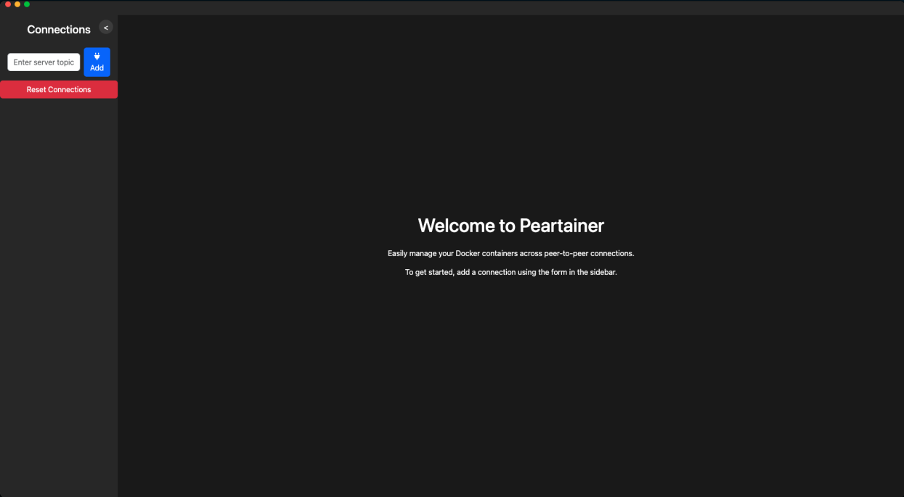
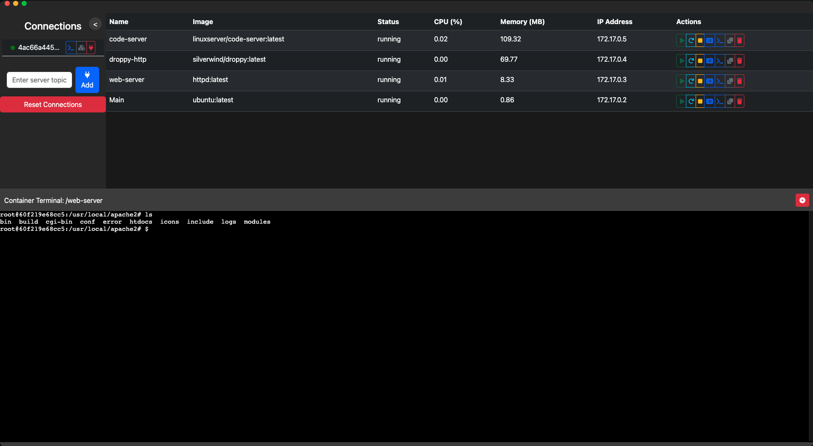
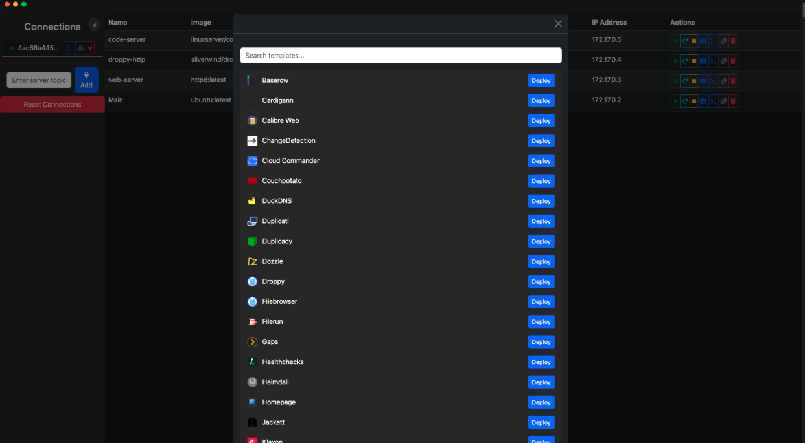
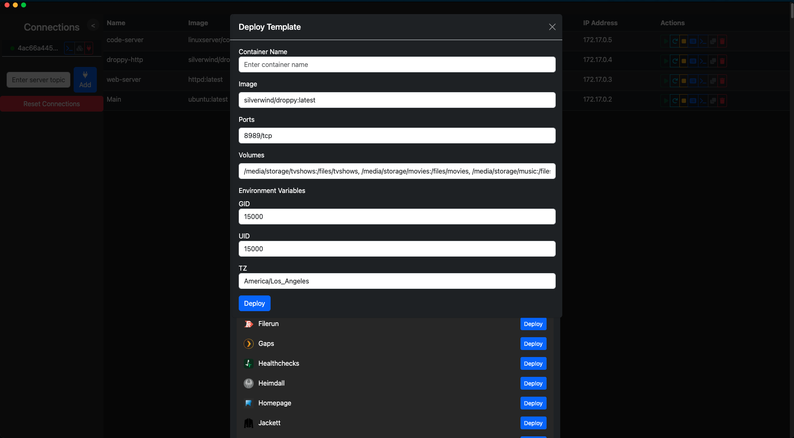
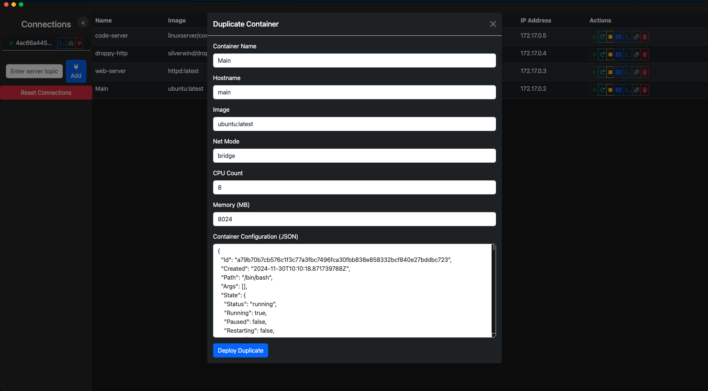
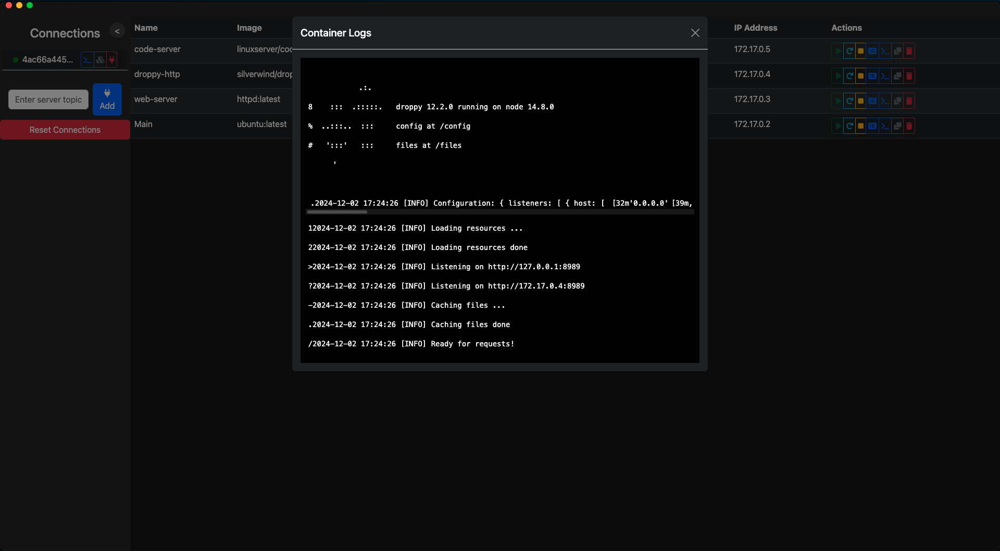

# pear-gpu

A peer-to-peer Docker/GPU host manager built on [Pear](https://docs.pears.com/) and
[Hyperswarm](https://github.com/holepunchto/hyperswarm). It is based on **peardock** (the
`package.json` name is still `peardock`) and extends it with hooks into a GPU registry service so
that a host's GPU usage sessions can be tracked and time-limited.

There are two parts:

- **Server** (`server/server.js`) — a Node.js process that runs on the machine with Docker (and the GPU). It joins a Hyperswarm topic derived from a `SERVER_KEY` and executes Docker commands received from connected peers via [Dockerode](https://github.com/apocas/dockerode).
- **Client** (`index.html`, `app.js`, `libs/`) — a Pear desktop app that connects to a server by its key and provides the UI.

No central server is needed for the peer connection itself; peers find each other through the Hyperswarm DHT.

## Features

### Server

- **Persistent server key** — on first run a 32-byte `SERVER_KEY` is generated and saved to `.env`, then reused. Pass `--new` to rotate it.
- **Session time limit** — `--time <seconds>` shuts the server down that many seconds after a peer connects.
- **GPU registry integration** — on start it looks up its GPU record (matched by server key) from a registry API on `localhost:8282` (`GET /gpus`) and records each peer connection with `POST /gpus/:id/connection-time`. The registry service is not part of this repo (needs confirmation which project provides it).
- **Docker management** over the peer connection: list, inspect, start, stop, restart, remove, duplicate (with custom CPU, memory, network mode and hostname) and deploy containers.
- **Terminals** — interactive shell sessions inside containers, plus a Docker CLI terminal on the host.
- **Logs and live stats** — container logs and streamed CPU / memory / network stats.

Commands are JSON messages of the form `{ command, args }`. Supported commands in `server/server.js`: `listContainers`, `inspectContainer`, `dockerCommand`, `logs`, `duplicateContainer`, `startContainer`, `stopContainer`, `restartContainer`, `removeContainer`, `deployContainer`, `startTerminal`, `killTerminal`.

### Client

- Bootstrap UI with an [xterm.js](https://xtermjs.org/) terminal viewer (`libs/terminal.js`, `libs/dockerTerminal.js`).
- Real-time per-container stats and logs.
- Template deployment wizard (`libs/templateDeploy.js`) using the public [Lissy93/portainer-templates](https://github.com/Lissy93/portainer-templates) list; ports, volumes and environment variables can be customised before deploying.

## Tech stack

Pear (desktop runtime), Hyperswarm, `hypercore-crypto`, `b4a`, Dockerode, `dotenv`, `node-fetch`, xterm.js, Bootstrap. Tests use [brittle](https://github.com/holepunchto/brittle).

## Prerequisites

- Docker, running, and accessible by the user running the server (on Linux: `sudo usermod -aG docker $USER`, then log out/in). The server uses `/var/run/docker.sock`, or the Docker Desktop named pipe on Windows.
- Node.js (v16+)
- Pear runtime for the client: `npm install -g pear`
- For GPU tracking: the GPU registry API listening on `localhost:8282` (optional — errors are logged if it is unavailable)

## Installation

```bash
npm install
```

`server/` has no `package.json` of its own. The server also imports `hypercore-crypto`, which is not listed in the root `package.json`, so install it if it is missing:

```bash
npm install hypercore-crypto
```

## Running

### Server

```bash
cd server
node server.js            # load SERVER_KEY from .env, or generate one
node server.js --new      # generate and save a new SERVER_KEY
node server.js --time 3600  # shut down 3600 s after a peer connects
```

The server prints its topic (the server key); give it to the client to connect.

### Client

```bash
npm run dev               # pear run -d .
```

Then add a connection in the app and enter the server key.

## Configuration

| Variable | Where | Description |
| --- | --- | --- |
| `SERVER_KEY` | `server/.env` (loaded with `dotenv`) | Hex-encoded 32-byte key that defines the Hyperswarm topic. Created automatically if missing. |

The `.env` file holds the server key and should not be committed; anyone with the key can control the Docker host.

## Scripts

| Script | Command |
| --- | --- |
| `npm run dev` | `pear run -d .` — run the client in development mode |
| `npm test` | `brittle test/*.test.js` (the test file currently contains no tests) |

## Project structure

```
index.html             Client UI (Pear desktop app entry)
app.js                 Client logic: Hyperswarm connection, container list, stats, actions
libs/terminal.js       Container terminal sessions (xterm.js)
libs/dockerTerminal.js Docker CLI terminal
libs/templateDeploy.js Template list and deploy modal
server/server.js       Server: key management, GPU registry calls, Docker command handling
screenshots/           UI screenshots
test/                  brittle test entry
```

## Screenshots

| | |
| --- | --- |
|  |  |
|  |  |
|  |  |

## Security notes

- Treat `SERVER_KEY` like a credential: anyone who has it can manage containers and open shells on the host.
- Rotate it with `--new` if it is exposed.

## Acknowledgments

Based on peardock. Built with Hyperswarm and Dockerode; inspired by Portainer.

## License

Apache-2.0 (per `package.json`).
